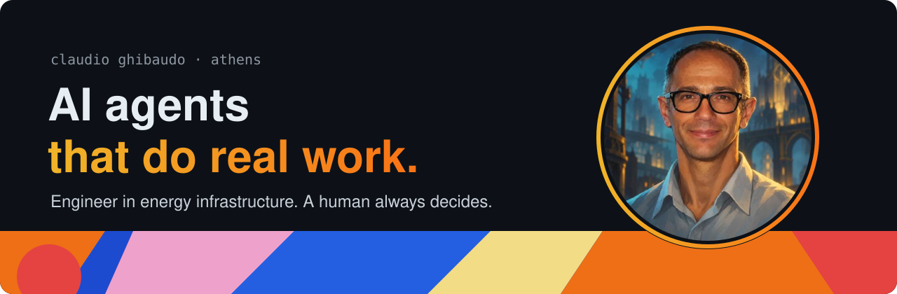

I'm an engineer working in energy infrastructure, based in Athens. Most of my day is mail, meetings, deadlines and documents across dozens of parallel projects, so I build AI agent systems that carry that load with me, on my own machine.

One rule runs through all of them: **the agent reads everything and proposes; I decide.**

|  |  |
|---|---|
| **01 · read** | every mail, every attachment, every transcript, in full |
| **02 · propose** | recaps, destinations, deadlines, drafts, with reasons |
| **03 · decide** | nothing moves, closes or leaves the machine without my OK |

## Selected work

| Project | What it is |
|---|---|
| [**Menagerie**](https://github.com/Claudibot1974/mail-agent-blueprint) | A blueprint any AI coding agent can turn into your personal email chief-of-staff: local, human-approved, no cloud. Built from a system I run every day on 7,000+ mails. |

## What I'm exploring

- **Protocol-driven agents:** plain-English rule files that make every AI session behave the same way.
- **Human-in-the-loop by design:** approval, undo and dry runs as features, not afterthoughts.
- **Local-first assistants:** private data stays on the machine; anything that leaves is explicit and previewed.
- **Agents for engineering work:** field data, technical documents and operational reporting.

Built with Claude Code. Opinions are my own.
